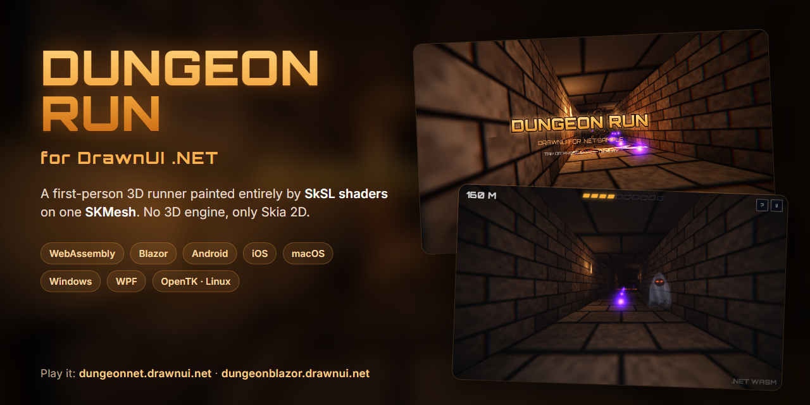

# Dungeon Run for DrawnUI .NET

Dungeon Run is a first-person dungeon runner you play in the browser. It is a port of the
[DrawnUI for Rust example](https://run.drawnui.net) to DrawnUI for .NET: the same game and the same look, with no 3D
API, only Skia 2D. It runs in the browser (pure .NET WebAssembly and Blazor), on the desktop (OpenTK and WPF) and on
Android, iPhone, iPad, Mac and Windows (.NET MAUI).

Play it: [dungeonnet.drawnui.net](https://dungeonnet.drawnui.net) (.NET WebAssembly) or
[dungeonblazor.drawnui.net](https://dungeonblazor.drawnui.net) (Blazor).

## The same game in other engines

The same game, with the same shaders, screens and rules, is also built with the other DrawnUI engines:

| Engine | Play | Source |
|---|---|---|
| DrawnUI for .NET (this repo) | [dungeonnet.drawnui.net](https://dungeonnet.drawnui.net), [dungeonblazor.drawnui.net](https://dungeonblazor.drawnui.net) | here |
| DrawnUI for Rust | [run.drawnui.net](https://run.drawnui.net) | [DrawnUi.Rust/examples/dungeon](https://github.com/DrawnUi/DrawnUi.Rust/tree/main/examples/dungeon) |
| DrawnUi.React | [dungeonreact.drawnui.net](https://dungeonreact.drawnui.net) | [DrawnUi.React/samples/dungeon](https://github.com/DrawnUi/DrawnUi.React/tree/master/samples/dungeon) |

This demo shows a full 3D world painted by SkSL shaders in a .NET app. One `SKMesh` carries the scene's triangles
(floor, walls, pillars, sprites) and tells each pixel which surface it is on; the shaders do all the painting.

## The shaders

All the shaders are the game's own SkSL, written for Dungeon Run and shared word for word with the Rust version, in
`src/Dungeon.Shared/Game/Shaders.cs`. Skia compiles them at run time (`SKRuntimeEffect`) and runs them on the GPU.
SkiaSharp has no built-in 3D lighting: everything you see is drawn by these shaders.

- `MESH_FS` is the dungeon itself, about 270 lines: ten materials (floor, ceiling, wall, lava, rune pillar, orb,
  flame, beam and two power-ups), procedural bricks with bevels, flickering torches every 10 units, fog, glowing
  runes, the lava, and the daylight and sky behind the exit.
- `POST` adds the effects over the whole picture: color fringes and a vignette at the edges, grain, the red of a hit,
  the orb pickup pulse, the health and shield auras, the surge rays and the ghost's blackout.
- `GLOW`, `CURTAIN` and `DIALOG` draw the glowing titles, the GAME OVER burn and the dialog panels.
- `MESH_VS` is short on purpose: the positions come projected from the CPU, so it only hands the values on.

## Why SKMesh

A shader alone only knows "I am pixel x, y". `SKMesh` tells it what it is drawing. Every frame:

- **The C# code builds the triangles.** Every visible quad (floor, walls, ceiling, lava, pillars, and the sprites for
  orbs, flames, beam, ghost and power-ups) is clipped at the near plane and projected to the screen on the CPU. All of
  it goes into one mesh, drawn with one `DrawMesh` call (`src/Dungeon.Shared/Game/Scene.cs`).
- **`SKMesh` finds which triangle covers each pixel**, and gives the pixel that surface's values, blended between its
  corners with perspective correction: world position, texture position, material, lava glow, normal and a random
  seed. That's 12 numbers per pixel.
- **`MESH_FS` paints the pixel from those numbers.**

Why not without `SKMesh`:

- **SkiaSharp's `DrawVertices`** blends only 2 numbers plus one 8-bit color per pixel, not the 12 the lighting needs.
  The alternative is one draw per quad with that quad's values passed in: thousands of draw calls per frame.
- **One full-screen shader** could trace the corridor itself, but that is a different renderer: every pixel would have
  to test the walls, pillars and sprites, which costs far more per pixel.

The `SKMesh` API comes from DrawnUi (`using DrawnUi.Draw.Meshes;`): it has the same classes and methods as SkiaSharp's
upcoming `SKMesh`, so when SkiaSharp ships its own, removing that one `using` line switches the game to it.

Here the mesh's vertex shader has nothing to do. For an example where it does the 3D work on the GPU (rotating,
projecting and lighting a model loaded from an OBJ file), see the OBJ screen of DrawnUi's Blazor sandbox:
[`SkMeshRocketProbe.razor`](https://github.com/DrawnUi/DrawnUi.Net/blob/main/src/Blazor/Samples/BlazorSandbox/Pages/SkMeshRocketProbe.razor).

## How to play

You run forward by yourself. Stay alive as long as you can.

| Action      | Keyboard                                  | Touch                                |
| ----------- | ----------------------------------------- | ------------------------------------ |
| Start       | Space, Enter                              | Tap                                  |
| Change lane | Left / Right, A / D (hold to keep moving) | Drag left or right (finger or mouse) |
| Jump        | Up, W, Space                              | Tap or click anywhere                |
| Help        | F1 (a browser may keep F1 for its own help) | The ? button                       |
| Pause (home or resume) | P, Escape                        | The II button                        |

- **Rune pillars**: change lane.
- **Red beam** and **lava**: jump.
- **Orbs**: a little health each (ten fill one cell). They come in rows of three: the third of a row taken without a
  miss counts double. The orbs lead to the lane the next pillars leave free.
- **The distance is the score**: how far you got, top left, in meters. The dungeon ends at 3000 m: the last hazards
  stand at 2900 m, the corridor straightens and brightens toward the daylight at its end, and the outside shows
  through the open doorway. Out of the door the run is over: YOU ESCAPED! with your time; the title keeps the
  session's best. That screen stays until a key or a tap.
- **Ghost**: hangs in any lane. Far away only its eyes burn; as you come near the torches dim, the fog thickens, then
  it reveals itself and lunges. It takes three tenths of your health in a blackout; the one that takes the last of it
  stays over you while you lie there. Change lane.
- **Green cross**: gives 15 percent of your health back, in a green aura.
- **Surge** (cyan arrows): four seconds much faster, and nothing hurts you; rays of light fly past along the borders
  of the screen and fade as the time runs out.
- **Shield** (golden): SHIELD ON, and for ten seconds the next pillar or ghost costs nothing (beams and lava still
  burn); a golden aura at the borders while it holds, a golden flash and ABSORBED! when it takes the hit.
- Running itself wears you down: a cell of health every four seconds, so the orbs are what keeps you going. A pillar
  takes two tenths of your health, a beam or lava one tenth, a ghost three. The run ends at zero. After a hit nothing
  hurts you for a moment.
- The run gets faster with distance, and the colors change every 400 units.

A run starts calm: few hazards, pillars before the first jumps, the full share after about 40 seconds. In that start
every hazard comes with a prompt, JUMP or CHANGE LANE; after it, the first three of each kind in a session. Once a
session: YOU TIRE AS YOU RUN at the second cell lost, COLLECT ORBS TO HEAL after the first hit, AVOID GHOSTS after the
first ghost gone by; LOW HEALTH under four cells. Every twelve seconds without a hit a word of praise shows instead.

A run starts with a countdown. When the health is gone, GAME OVER stays over the still living dungeon until a key or
a tap (TAP OR PRESS SPACE TO CONTINUE), then its picture burns away over the title's run.

The title screen plays the game by itself until you start.

## Run it

You need the .NET 10 SDK and the `wasm-tools` workload. Check both before the first build:

```
dotnet --version
dotnet workload list
```

`dotnet --version` must show 10.x, and `dotnet workload list` must list `wasm-tools`
(`dotnet workload install wasm-tools` adds it).

DrawnUI comes from NuGet (version in `Directory.Build.props`), so a plain clone builds. To build against the DrawnUI
source instead, clone [DrawnUi.Net](https://github.com/DrawnUi/DrawnUi.Net) next to this folder as `..\DrawnUi` and add
`-p:UseDrawnUiSource=true` to the `dotnet` commands below.

Run the web head from this folder:

```
dotnet run --project src/Dungeon.Web
```

Then open http://localhost:5871. The first build takes a few minutes (it links Skia into the WebAssembly runtime).

Or run the Blazor head, the same game in a Blazor WebAssembly app:

```
dotnet run --project src/Dungeon.Blazor
```

Then open http://localhost:5873. To debug it with breakpoints, start it from the IDE's debugger (Visual Studio F5,
or VS Code Run and Debug): its launch profile carries the WebAssembly debug proxy.

Or run it on the desktop, in a window:

```
dotnet run --project src/Dungeon.OpenTk
dotnet run --project src/Dungeon.Wpf
```

The OpenTK head runs on Windows and Linux, the WPF head on Windows.

On Windows, the .NET MAUI head in a window (unpackaged, with the .NET MAUI workload):

```
dotnet build src/Dungeon.Maui -t:Run -f net10.0-windows10.0.19041.0
```

On Android (a device or an emulator), with the .NET MAUI workload:

```
dotnet build src/Dungeon.Maui -t:Run -f net10.0-android
```

On a Mac with Xcode and the .NET MAUI workload, the iOS simulator and Mac Catalyst need no signing setup:

```
dotnet build src/Dungeon.Maui -t:"Build;Run" -f net10.0-ios -p:RuntimeIdentifier=iossimulator-arm64
dotnet run --project src/Dungeon.Maui -f net10.0-maccatalyst
```

(`iossimulator-x64` on an Intel Mac; pick a simulator with `-p:_DeviceName=:v2:udid=<UDID>` from
`xcrun simctl list devices available`.)

On an iPhone, the build signs with the Apple development identity your Mac has. Name your own identity on the command
line:

```
dotnet build src/Dungeon.Maui -t:"Build;Run" -f net10.0-ios -p:RuntimeIdentifier=ios-arm64 -p:_DeviceName=<UDID> -p:CodesignKey="Apple Development: Your Name (XXXXXXXXXX)"
```

or once, in a file of your own: copy `src/Dungeon.Maui/Signing.local.props.example` to
`src/Dungeon.Maui/Signing.local.props` (git ignores it) and fill it in. Your identities: `security find-identity -v -p
codesigning`; your phone's UDID: `xcrun devicectl list devices`. The app id is `net.drawnui.dungeonrun`: your team needs a
development provisioning profile that covers it (Xcode makes one when you let it manage signing for that id, or use a
wildcard profile and add `-p:CodesignProvision="<profile name>"`).

One desktop exe that needs no .NET installed:

```
dotnet publish src/Dungeon.OpenTk -c Release -r win-x64 -o publish
```

(or `-r linux-x64`).

Every head shows the framework's name in the bottom right corner. Set `DungeonApp.ShowWatermark = false;` before the
game is built to hide it, for example for clean captures.

Run the tests:

```
dotnet test tests/Dungeon.Tests
```

## Project layout

- `src/Dungeon.Shared`: the game, shared by every head (the rules, the mesh scene, the SkSL, the HUD and dialogs).
- `src/Dungeon.Web`: the browser head on DrawnUi.Web (pure WebAssembly, no Blazor).
- `src/Dungeon.Blazor`: the browser head on DrawnUi.Blazor (Blazor WebAssembly).
- `src/Dungeon.OpenTk`: the desktop head on DrawnUi.OpenTk (an OpenTK window, Windows and Linux).
- `src/Dungeon.Wpf`: the desktop head on DrawnUi.Wpf (a WPF window, Windows).
- `src/Dungeon.Maui`: the .NET MAUI head on DrawnUi.Maui (Android, iOS, Mac Catalyst, Windows).
- `tests/Dungeon.Tests`: tests of the rules of the run.
- `tools/Dungeon.Profile`: a headless profile of the frame's allocations on DrawnUi.Net.

## Status

Works: the whole run (rules, mesh, lighting, fog, lava, ghosts, power-ups, the exit and YOU ESCAPED!), the post
effect, the HUD, the prompts and lessons, the countdown, GAME OVER and its burning curtain, the title's own run,
keyboard, drag and tap, hover on the buttons, the help and pause dialogs, and the screen-reader tree.

It plays the same as the Rust original: the same rules, shaders, screens and texts.

Frame rate: a steady 60 FPS on the title and in a run, on both browser heads (web and Blazor, in Chrome) and on both
desktop heads (OpenTK and WPF), and on the .NET MAUI head on Windows.

## Create With AI

DrawnUI comes with ready skills for AI coding agents. Give your agent the skills and it writes DrawnUI code the way
the engine expects: controls, layouts, caching, game loops, shaders, meshes, the web head.

This port was made with an AI coding agent. It read the Rust game and rebuilt it in C#, screen by screen, with these
skills:

- [drawnui](https://drawnui.net/skills/drawnui/SKILL.md): the framework, controls, layouts, caching, gestures.
- [drawnui-fluent](https://drawnui.net/skills/drawnui-fluent/SKILL.md): building the UI in fluent C#.
- [drawnui-game](https://drawnui.net/skills/drawnui-game/SKILL.md): the game loop, input and game patterns on
  `DrawnGame`.
- [drawnui-web-app](https://drawnui.net/skills/drawnui-web-app/SKILL.md): the pure WebAssembly head on DrawnUi.Web.
- [skmech](https://drawnui.net/skills/skmech/SKILL.md): `SKMesh` with SkSL, specification, buffers, `DrawMesh` and
  the traps.
- [drawnui-port-net-to-rust](https://hellorust.drawnui.net/skills/drawnui-port-net-to-rust/SKILL.md): the C# and
  Rust mapping, read the other way round to port Rust to C#.

To install a skill for Claude Code, save it as `~/.claude/skills/<name>/SKILL.md` (or in your agent's skill or rules
folder). Every DrawnUI skill is listed at https://drawnui.net/llms.txt.

## Credits and license

The game is ported from the Dungeon Run example of
[DrawnUI for Rust](https://github.com/DrawnUi/DrawnUi.Rust/tree/main/examples/dungeon). Fonts: Orbitron
(SIL Open Font License) and Noto Sans Math (SIL Open Font License).

MIT License, see [LICENSE](LICENSE).
